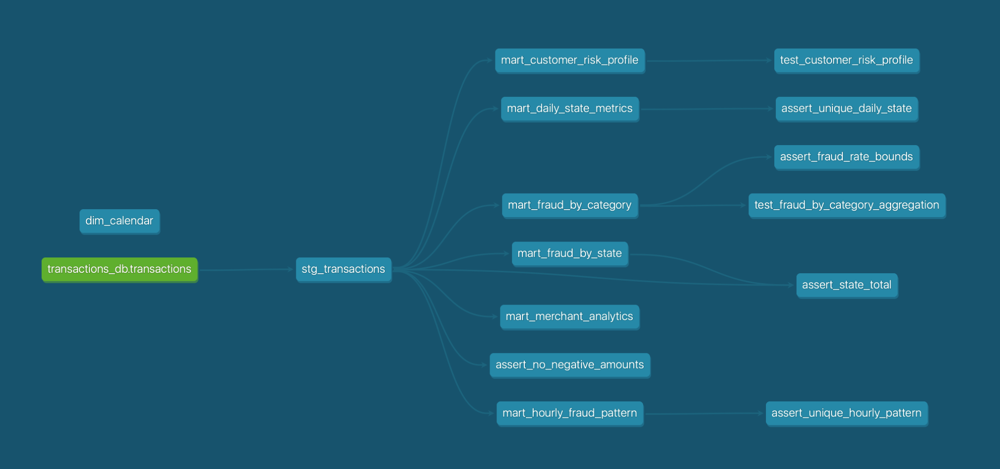

# Создание моделей на dbt

В данном проекте проводится создание витрин данных, тестов и макросов из данных по транзакциям, хранящихся в ClickHouse

## Витрины

1. ```mart_daily_state_metrics``` — Дневные метрики по штатам

2. ```mart_fraud_by_category``` — Анализ фрода по категориям

3. ```mart_fraud_by_state``` — Географический анализ фрода

4. ```mart_customer_risk_profile``` — Профиль риска клиентов

5. ```mart_hourly_fraud_pattern``` — Временные паттерны фрода

6. ```mart_merchant_analytics``` — Аналитика по мерчантам

## Тестирование
В проекте используются:

1. Стандартные data tests (models/marts/schema.yml и models/staging/schema.yml)

2. Тесты из dbt_utils и dbt_expectations (models/marts/schema.yml)

3. Singular SQL tests (tests/)

4. Unit тесты (models/marts/unit_tests.yml)

## Зависимости


## Дополнительно
Настройка ```sqlfluff``` содержится в .sqlfluff и настройка pre-```commit``` в .pre-commit-config.yaml

Версии фреймворков:
1. dbt-core==1.12.6
2. dbt-clickhouse==1.10.3
## Запуск

- Сборка и запуск тестов: ```make debug```

- Проверка SQL: ```make lint```

- Форматирование SQL: ```make format```

- Полный цикл с документацией: ```make all```

## Логи тестов 
```bash
(.venv) t.i@MacBook-Air-Timur fraud_project % dbt test
16:54:14  Running with dbt=1.12.6
16:54:14  Registered adapter: clickhouse=1.10.3
16:54:15  [WARNING]: Configuration paths exist in your dbt_project.yml file which do not apply to any resources.
There are 3 unused configuration paths:
- models.fraud_project.marts
- models.fraud_project.raw
- models.fraud_project.staging
16:54:15  Found 8 models, 39 data tests, 1 source, 985 macros, 2 unit tests
16:54:15  
16:54:15  Concurrency: 4 threads (target='dev')
16:54:15  
16:54:15  1 of 41 START test accepted_values_mart_customer_risk_profile_risk_level__HIGH__MEDIUM__LOW  [RUN]
16:54:15  2 of 41 START test accepted_values_mart_merchant_analytics_is_suspicious__False__0__1  [RUN]
16:54:15  3 of 41 START test accepted_values_stg_transactions_amount_segment__UNKNOWN__INVALID__LOW__MEDIUM__HIGH__VERY_HIGH  [RUN]
16:54:15  4 of 41 START test accepted_values_stg_transactions_is_fraud__False__0__1 ...... [RUN]
16:54:15  1 of 41 PASS accepted_values_mart_customer_risk_profile_risk_level__HIGH__MEDIUM__LOW  [PASS in 0.05s]
16:54:15  5 of 41 START test assert_fraud_rate_bounds .................................... [RUN]
16:54:15  2 of 41 PASS accepted_values_mart_merchant_analytics_is_suspicious__False__0__1  [PASS in 0.07s]
16:54:15  6 of 41 START test assert_no_negative_amounts .................................. [RUN]
16:54:15  4 of 41 PASS accepted_values_stg_transactions_is_fraud__False__0__1 ............ [PASS in 0.07s]
16:54:15  3 of 41 PASS accepted_values_stg_transactions_amount_segment__UNKNOWN__INVALID__LOW__MEDIUM__HIGH__VERY_HIGH  [PASS in 0.08s]
16:54:15  7 of 41 START test assert_state_total .......................................... [RUN]
16:54:15  8 of 41 START test assert_unique_daily_state ................................... [RUN]
16:54:15  6 of 41 PASS assert_no_negative_amounts ........................................ [PASS in 0.03s]
16:54:15  9 of 41 START test assert_unique_hourly_pattern ................................ [RUN]
16:54:15  8 of 41 PASS assert_unique_daily_state ......................................... [PASS in 0.02s]
16:54:15  10 of 41 START test dbt_expectations_expect_column_values_to_be_between_mart_fraud_by_category_fraud_rate__100__0  [RUN]
16:54:15  5 of 41 PASS assert_fraud_rate_bounds .......................................... [PASS in 0.06s]
16:54:15  11 of 41 START test dbt_utils_unique_combination_of_columns_mart_daily_state_metrics_transaction_date__us_state  [RUN]
16:54:15  7 of 41 PASS assert_state_total ................................................ [PASS in 0.04s]
16:54:15  12 of 41 START test dbt_utils_unique_combination_of_columns_mart_hourly_fraud_pattern_day_of_week__transaction_hour  [RUN]
16:54:15  9 of 41 PASS assert_unique_hourly_pattern ...................................... [PASS in 0.05s]
16:54:15  13 of 41 START test not_null_mart_customer_risk_profile_customer_key ........... [RUN]
16:54:15  11 of 41 PASS dbt_utils_unique_combination_of_columns_mart_daily_state_metrics_transaction_date__us_state  [PASS in 0.04s]
16:54:15  14 of 41 START test not_null_mart_customer_risk_profile_risk_level ............. [RUN]
16:54:15  10 of 41 PASS dbt_expectations_expect_column_values_to_be_between_mart_fraud_by_category_fraud_rate__100__0  [PASS in 0.06s]
16:54:15  12 of 41 PASS dbt_utils_unique_combination_of_columns_mart_hourly_fraud_pattern_day_of_week__transaction_hour  [PASS in 0.04s]
16:54:15  15 of 41 START test not_null_mart_daily_state_metrics_transaction_count ........ [RUN]
16:54:15  16 of 41 START test not_null_mart_daily_state_metrics_transaction_date ......... [RUN]
16:54:15  13 of 41 PASS not_null_mart_customer_risk_profile_customer_key ................. [PASS in 0.03s]
16:54:15  17 of 41 START test not_null_mart_daily_state_metrics_us_state ................. [RUN]
16:54:15  14 of 41 PASS not_null_mart_customer_risk_profile_risk_level ................... [PASS in 0.03s]
16:54:15  18 of 41 START test not_null_mart_fraud_by_category_category ................... [RUN]
16:54:15  16 of 41 PASS not_null_mart_daily_state_metrics_transaction_date ............... [PASS in 0.02s]
16:54:15  15 of 41 PASS not_null_mart_daily_state_metrics_transaction_count .............. [PASS in 0.03s]
16:54:15  17 of 41 PASS not_null_mart_daily_state_metrics_us_state ....................... [PASS in 0.02s]
16:54:15  19 of 41 START test not_null_mart_fraud_by_category_fraud_count ................ [RUN]
16:54:15  21 of 41 START test not_null_mart_fraud_by_category_transaction_count .......... [RUN]
16:54:15  20 of 41 START test not_null_mart_fraud_by_category_fraud_rate ................. [RUN]
16:54:15  18 of 41 PASS not_null_mart_fraud_by_category_category ......................... [PASS in 0.03s]
16:54:15  22 of 41 START test not_null_mart_fraud_by_state_fraud_rate .................... [RUN]
16:54:15  19 of 41 PASS not_null_mart_fraud_by_category_fraud_count ...................... [PASS in 0.03s]
16:54:15  21 of 41 PASS not_null_mart_fraud_by_category_transaction_count ................ [PASS in 0.03s]
16:54:15  20 of 41 PASS not_null_mart_fraud_by_category_fraud_rate ....................... [PASS in 0.02s]
16:54:15  23 of 41 START test not_null_mart_fraud_by_state_us_state ...................... [RUN]
16:54:15  25 of 41 START test not_null_mart_hourly_fraud_pattern_fraud_rate .............. [RUN]
16:54:15  22 of 41 PASS not_null_mart_fraud_by_state_fraud_rate .......................... [PASS in 0.02s]
16:54:15  24 of 41 START test not_null_mart_hourly_fraud_pattern_day_of_week ............. [RUN]
16:54:15  26 of 41 START test not_null_mart_hourly_fraud_pattern_transaction_hour ........ [RUN]
16:54:15  25 of 41 PASS not_null_mart_hourly_fraud_pattern_fraud_rate .................... [PASS in 0.02s]
16:54:15  27 of 41 START test not_null_mart_merchant_analytics_is_suspicious ............. [RUN]
16:54:15  23 of 41 PASS not_null_mart_fraud_by_state_us_state ............................ [PASS in 0.03s]
16:54:15  24 of 41 PASS not_null_mart_hourly_fraud_pattern_day_of_week ................... [PASS in 0.02s]
16:54:15  26 of 41 PASS not_null_mart_hourly_fraud_pattern_transaction_hour .............. [PASS in 0.01s]
16:54:15  28 of 41 START test not_null_mart_merchant_analytics_merchant_name ............. [RUN]
16:54:15  29 of 41 START test not_null_stg_transactions_amount ........................... [RUN]
16:54:15  30 of 41 START test not_null_stg_transactions_amount_segment ................... [RUN]
16:54:16  27 of 41 PASS not_null_mart_merchant_analytics_is_suspicious ................... [PASS in 0.03s]
16:54:16  28 of 41 PASS not_null_mart_merchant_analytics_merchant_name ................... [PASS in 0.03s]
16:54:16  30 of 41 PASS not_null_stg_transactions_amount_segment ......................... [PASS in 0.02s]
16:54:16  29 of 41 PASS not_null_stg_transactions_amount ................................. [PASS in 0.03s]
16:54:16  31 of 41 START test not_null_stg_transactions_is_fraud ......................... [RUN]
16:54:16  32 of 41 START test not_null_stg_transactions_transaction_timestamp ............ [RUN]
16:54:16  33 of 41 START test not_null_stg_transactions_us_state ......................... [RUN]
16:54:16  34 of 41 START test source_accepted_values_transactions_db_transactions_target__False__0__1  [RUN]
16:54:16  34 of 41 PASS source_accepted_values_transactions_db_transactions_target__False__0__1  [PASS in 0.02s]
16:54:16  31 of 41 PASS not_null_stg_transactions_is_fraud ............................... [PASS in 0.03s]
16:54:16  33 of 41 PASS not_null_stg_transactions_us_state ............................... [PASS in 0.02s]
16:54:16  32 of 41 PASS not_null_stg_transactions_transaction_timestamp .................. [PASS in 0.03s]
16:54:16  36 of 41 START test unique_mart_customer_risk_profile_customer_key ............. [RUN]
16:54:16  35 of 41 START test source_not_null_transactions_db_transactions_transaction_time  [RUN]
16:54:16  37 of 41 START test unique_mart_fraud_by_category_category ..................... [RUN]
16:54:16  38 of 41 START test unique_mart_fraud_by_state_us_state ........................ [RUN]
16:54:16  35 of 41 PASS source_not_null_transactions_db_transactions_transaction_time .... [PASS in 0.03s]
16:54:16  37 of 41 PASS unique_mart_fraud_by_category_category ........................... [PASS in 0.02s]
16:54:16  36 of 41 PASS unique_mart_customer_risk_profile_customer_key ................... [PASS in 0.03s]
16:54:16  38 of 41 PASS unique_mart_fraud_by_state_us_state .............................. [PASS in 0.02s]
16:54:16  40 of 41 START unit_test mart_customer_risk_profile::test_customer_risk_profile  [RUN]
16:54:16  39 of 41 START test unique_mart_merchant_analytics_merchant_name ............... [RUN]
16:54:16  41 of 41 START unit_test mart_fraud_by_category::test_fraud_by_category_aggregation  [RUN]
16:54:16  39 of 41 PASS unique_mart_merchant_analytics_merchant_name ..................... [PASS in 0.03s]
16:54:16  41 of 41 PASS mart_fraud_by_category::test_fraud_by_category_aggregation ....... [PASS in 0.15s]
16:54:16  40 of 41 PASS mart_customer_risk_profile::test_customer_risk_profile ........... [PASS in 0.17s]
16:54:16  
16:54:16  Finished running 39 data tests, 2 unit tests in 0 hours 0 minutes and 0.82 seconds (0.82s).
16:54:16  
16:54:16  Completed successfully
16:54:16  
16:54:16  Done. PASS=41 WARN=0 ERROR=0 SKIP=0 NO-OP=0 REUSED=0 TOTAL=41
```